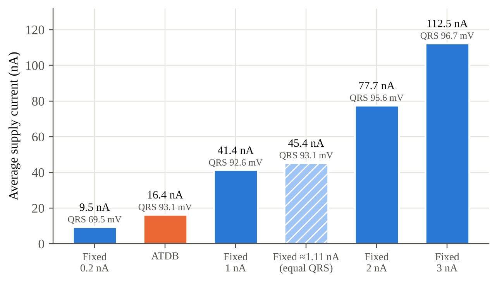

# Activity-Triggered Dynamic Bias (ATDB) ECG Amplifier


A nanowatt-level, inverter-based, current-reused ECG amplifier whose bias current rises only during the QRS complex. A fully analog loop senses the slope of the amplifier's own output and injects a bounded current into the single bias reference that every amplifier branch mirrors.

**Process:** Cadence GPDK090 (90 nm CMOS), 2 V supply · **Tools:** Cadence Virtuoso / Spectre, Python
**Course:** VIT Vellore, School of Electronics Engineering, Project-I (BECE497J), 2026

## Key results (transistor-level simulation)

| Metric | ATDB | Fixed bias, 1 nA |
|---|---|---|
| Total supply current | **16.38 nA** (detector included) | 41.36 nA |
| Total power | **32.8 nW** | 82.7 nW |
| QRS output (1 mV input) | 93.07 mV | 92.63 mV |

- Power saving: **2.53×** vs a fixed 1 nA bias (≈ 2.8× at exactly equal QRS amplitude; 6.9× vs fixed 3 nA)
- Bias reference: 0.248 nA at rest → 3.251 nA on each QRS (**13.1×**)
- Closed-loop gain ≈ 40 dB at every bias level; bandwidth 27 Hz → 582 Hz from 0.2 nA to 5 nA
- Input noise (1–30 Hz): 25.1 µVrms at rest, 7.2 µVrms during the QRS; flicker share cut from 43% to 4%
- Stable with no ECG input (no self-triggering)



## Design values

| Parameter | Value |
|---|---|
| Reference current I29 | 0.2 nA |
| Injector rest gate voltage Vinj | 1.76 V |
| RD1 / R2Bias | 600 MΩ / 125 MΩ |
| Input pair m1/m2 | 10.88 µm / 2 µm |
| m3/m4 | 26.58 µm / 2 µm, m = 2 |
| Input gate biases | 1.45 V (PMOS), 0.36 V (NMOS) |
| Cin / Cf | 40 pF / 400 fF (gain ≈ 100) |

## Repository layout

```
docs/      Project report (.docx), A0 poster (.pptx + PDF preview), review slides
figures/   Result charts, block diagram, OTA and ATDB-chain schematics
netlist/   Spectre netlist (11 Oct 2026, BEFORE final tuning; see note)
scripts/   Python used to plot the charts and build the report and poster
```

## Notes and limitations

- `netlist/` holds the 11 Oct 2026 export, before the final values above (RD1, Vinj, input-pair size) were set. Replace it with a fresh export of the final schematic.
- AC (gain/bandwidth) and the flat-input check were simulated before the input pair was enlarged.
- Noise at rest is higher than state-of-the-art low-noise amplifiers (NEF ≈ 18). The cause is current spent in branches that do not set noise; redistributing current toward the input pair is the planned fix.
- Weak at the SS and FS process corners; a replica bias or trim is the planned fix.
- The scripts use absolute paths from the original working environment; adjust before running.

## Status

- [x] Design, simulation and corners
- [x] Report and poster
- [ ] Provisional patent (VIT IPR cell)
- [ ] Letter paper (after patent filing)
- [ ] Layout and post-layout simulation
